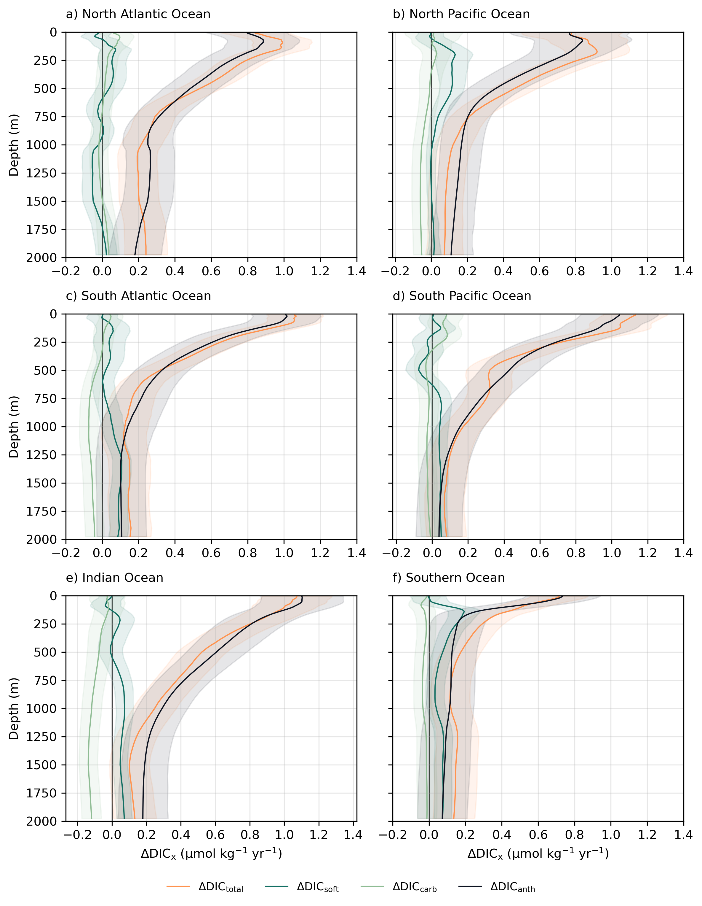

## Spatial redistribution of a globally stable marine biological carbon pump

#### **L. Delaigue1, 2\, R. Sauzède3, O. Sulpis4, P. W. Boyd5, L. D. Talley6, H. Claustre2, G-J Reichart1, 7 and M. P. Humphreys1**

<strong>Author Affiliations</strong>

1Department of Ocean Systems (OCS), NIOZ Royal Netherlands Institute for Sea Research, PO Box 59, 1790 AB Den Burg (Texel), the Netherlands  
2Sorbonne Université, CNRS, Laboratoire d’Océanographie de Villefranche, Villefranche-Sur-Mer, France  
3Sorbonne Université, CNRS, Institut de la Mer de Villefranche, Villefranche-Sur-Mer, France  
4CEREGE, Aix Marseille Univ, CNRS, IRD, INRAE, Collège de France, Aix-en-Provence, France  
5Institute for Marine and Antarctic Studies, University of Tasmania, Hobart, Tasmania, Australia
6Scripps Institution of Oceanography, University of California San Diego, La Jolla, CA, USA
7Department of Earth Sciences, Utrecht University, Utrecht, the Netherlands  

*Corresponding author: Louise Delaigue ([louise.delaigue@imev-mer.fr](mailto:louise.delaigue@imev-mer.fr))*

> [!IMPORTANT]  
> This study is currently under review for publication in Global Biogeochemical Cycles.

### Abstract
Marine dissolved inorganic carbon (DICtotal) is a key component of the global ocean carbon cycle. Over recent decades, DICtotal has increased due to rising anthropogenic CO2, but the response from the biological carbon pump (BCP), which transfers carbon from the surface to the ocean interior, remains uncertain. Here, we reconstruct global three-dimensional DIC changes from 2004 to 2024 down to 2km and separate anthropogenic, biological, and carbonate contributions. We find that while DICtotal increased throughout the water column, driven primarily by anthropogenic CO2, the global inventory of biologically respired carbon associated with the BCP remained statistically constant. This apparent stability masks pronounced regional and vertical redistribution of respired carbon within the ocean interior. In some regions, respired carbon accumulated at shallower depths, reducing its isolation from the atmosphere, whereas in others it was transported deeper, enhancing long-term storage. These contrasting patterns co-vary with changes in ocean stratification and ventilation, indicating that physical change may regulate where biologically respired carbon is retained. Although these redistributions had little net effect on the global carbon inventory over the study period, they reveal a structural reorganization of the BCP that may influence the ocean’s capacity to sequester carbon under continued climate change.

 
### Analysis and plotting
This repository contains the raw data and scripts used to generate the results presented in the manuscript. The Jupyter Notebook Figures and numbers includes the main visualizations and statistical outputs. For deeper exploration, interactive versions are available via Plotly.

> [!NOTE]  
> This repository does not include data files due to the large file sizes. However, all these files can be made available upon request, along with the GCC-DIC dataset.

### License
This project is licensed under the GNU General Public License v3.0 – see the LICENSE file for details.

