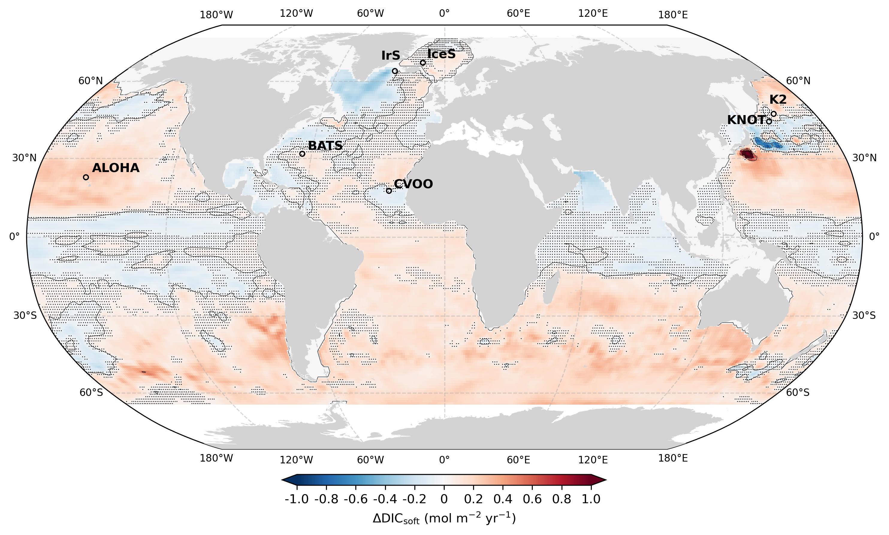

## Spatial redistribution of a globally stable marine biological carbon pump

#### **L. Delaigue1, 2, R. Sauzède3, O. Sulpis4, P. W. Boyd5, L. D. Talley6, H. Claustre2, G.-J. Reichart1, 7 and M. P. Humphreys1**

<strong>Author affiliations</strong>

1Department of Ocean Systems (OCS), NIOZ Royal Netherlands Institute for Sea Research, PO Box 59, 1790 AB Den Burg (Texel), the Netherlands  
2Sorbonne Université, CNRS, Laboratoire d’Océanographie de Villefranche, Villefranche-sur-Mer, France  
3Sorbonne Université, CNRS, Institut de la Mer de Villefranche, Villefranche-sur-Mer, France  
4CEREGE, Aix Marseille Univ, CNRS, IRD, INRAE, Collège de France, Aix-en-Provence, France  
5Institute for Marine and Antarctic Studies, University of Tasmania, Hobart, Tasmania, Australia  
6Scripps Institution of Oceanography, University of California San Diego, La Jolla, CA, USA  
7Department of Earth Sciences, Utrecht University, Utrecht, the Netherlands  

*Corresponding author: Louise Delaigue ([louise.delaigue@imev-mer.fr](mailto:louise.delaigue@imev-mer.fr))*

> [!IMPORTANT]  
> This study is under review in *Global Biogeochemical Cycles*.
> Preprint: ESS Open Archive, [https://essopenarchive.org/doi/full/10.22541/essoar.15010559/v1](https://essopenarchive.org/doi/full/10.22541/essoar.15010559/v1)

### Abstract
Marine dissolved inorganic carbon (DICtotal) is a key component of the global ocean carbon cycle. Over recent decades, DICtotal has increased due to rising anthropogenic CO2, but the response from the biological carbon pump (BCP), which transfers carbon from the surface to the ocean interior, remains uncertain. Here, we reconstruct global three-dimensional DIC changes from 2004 to 2024 down to 2 km depth and distinguish contributions from anthropogenic, organic matter remineralization, and calcium carbonate cycling. We find that while DICtotal increased throughout the water column, driven primarily by anthropogenic CO2, the global inventory of biologically respired carbon associated with the BCP remained constant. However, this apparent stability masked pronounced regional and vertical redistribution of respired carbon within the ocean interior. In some regions, respired carbon accumulated at shallower depths, reducing its isolation from the atmosphere, whereas in others it was transported deeper, enhancing long-term storage. These contrasting patterns co-vary with changes in upper-ocean stratification and with the ventilation state of the ocean interior, indicating that both regulate where biologically respired carbon is retained. Although these redistributions did not impact the net global carbon inventory over the study period, they reveal a structural reorganization of the BCP that may influence the ocean’s capacity to sequester carbon under continued climate change.

### Approach
Monthly 1° × 1° fields of DIC, total alkalinity (TA), temperature, salinity and O2 from GCC-DIC v2.3 (CONTENT applied to GOBAI-O2 v2.3, 2004–2024, 0–2000 dbar) are used to decompose DICtotal into:

- DICsoft = (117/170) × ΔAOU, soft-tissue carbon from organic matter remineralization (C:−O2 = 117:170, Anderson and Sarmiento, 1994);
- DICcarb = 0.5 × (ΔTA + (16/170) × ΔAOU), carbonate carbon from CaCO3 dissolution, with TA corrected for nitrate released by remineralization (N:−O2 = 16:170);
- DICanth = ΔDICtotal − DICsoft − DICcarb, the residual, dominated by anthropogenic CO2.

Linear trends (μmol kg−1 yr−1, or mol m−2 yr−1 when depth-integrated) are computed with a 1000-member Monte Carlo that perturbs DIC, TA and AOU by their mapping uncertainties and the two ratios by their uncertainties (±0.092 and ±0.0081). A pixel is shown as robust when ≥ 80% of iterations give a significant trend of the same sign. The structural uncertainty of AOU is estimated from the difference between GOBAI-O2 and ML4O2. GCC-DIC trends are compared with in situ trends at seven time-series stations (`ocean-time-series-bcp/`).

### Repository contents

#### Scripts (global analysis, run in order)

| Script | Purpose | Output (`data/processing_steps/`) |
|---|---|---|
| `01A1_O2_product_structural_uncertainty.py` | Structural uncertainty of the global-mean AOU trend from GOBAI-O2 v2.3 vs ML4O2 (2004–2020, 0–1000 m) | `01A1_O2_product_structural_uncertainty.nc` |
| `01A2_DIC_globally_averaged_change_monte_carlo_online.py` | Global-mean trend profiles of DICtotal, DICsoft, DICcarb and DICanth (Fig. 1) | `01_DIC_globally_averaged_change_monte_carlo_online.nc` |
| `01B_DIC_basins_averaged_change_monte_carlo.py` | Same, averaged over each ocean basin of GOaS v1 (Fig. 2) | `01B_DIC_basins_averaged_<basin>.nc` |
| `02_DIC_integrated_change_map_monte_carlo_online_pres_diff.py` | 0–2000 dbar integrated DICsoft trend map with Monte Carlo robustness (Fig. 3) | `02_DIC_integrated_change_map_monte_carlo_online_pres_diff_with_sig_pres_ok.nc` |
| `03_DIC_sequestration_below_winter_MLD_monte_carlo_online.py` | Net DICsoft change at or below the maximum climatological mixed layer depth (MLD) (Fig. 6a) | `03_DIC_integrated_change_at_or_below_MLD_map_monte_carlo_online_pres_diff_with_sig.nc` |
| `04_DIC_sequestered_50_depth_interpolation.py` | Trend in the depth above which 50% of the DICsoft inventory sits (Fig. 6b) | `04_DIC_sequestered_50_depth_change.nc` |
| `05_DIC_soft_vertical_figure.py` | DICsoft profiles relative to the MLD (Fig. 7) | `05_DIC_soft_with_MLD.nc` |
| `06_N2_stratification_trend.py` | Trend in the 0–200 m mean Brunt–Väisälä frequency, N2 (s−2 yr−1) (Fig. 5) | `06_N2_stratification_trend.nc` |
| `07A_DIC_band_0_200.py`, `07B_DIC_band_200-1000.py`, `07C_DIC_band_1000_2000.py` | DICsoft trend maps in the 0–200, 200–1000 and 1000–1975 dbar bands (Fig. 5) | `07A_DIC_band_0_200_monte_carlo.nc`, `08_DIC_band_200_1000_monte_carlo.nc`, `09_DIC_band_1000_1975_monte_carlo.nc` |
| `08_OCIM_ideal_age.py` | Band-mean OCIM ideal age, a measure of ventilation (Fig. 5) | `09_OCIM_ideal_age.nc` |

#### Notebooks

| Notebook | Content |
|---|---|
| `Figures and numbers.ipynb` | Figs. 1–7 in manuscript order, and the numbers quoted in the text. Interactive Plotly versions for exploration |
| `Supplementary_figures.ipynb` | Surface to 1000 m distributions of DIC and TA (Figs. S1–S2) |
| `Compare_oxygen_products.ipynb` | GOBAI-O2 vs ML4O2 O2 trends, sign disagreement and trend detectability (SI) |
| `n2_dicsoft_correlation.ipynb` | Sign agreement between N2 and 0–200 dbar DICsoft trends (SI) |

#### Time-series stations: `ocean-time-series-bcp/`
In situ trends of DICtotal, DICsoft, DICcarb and DICanth at seven stations (ALOHA, BATS, CVOO, Iceland Sea, Irminger Sea, K2, KNOT; SPOTS, Lange et al., 2024, plus BATS bottle data) and comparison with GCC-DIC v2.3 (Fig. 4, Table S1 and SI figures). Self-contained, with its own `config.py`, shared module and scripts; see [`ocean-time-series-bcp/README.md`](ocean-time-series-bcp/README.md).

#### Figures

All figures are written to `figs/`.

| Figure | Content | Scripts |
|---|---|---|
| 1 | Global-mean trend profiles of each DIC component | `01A1`, `01A2` |
| 2 | Basin-mean trend profiles of each DIC component | `01B` |
| 3 | 0–2000 dbar integrated DICsoft change | `02` |
| 4 | In situ vs GCC-DIC trend profiles at time-series stations | `ocean-time-series-bcp/scripts/01`–`04` |
| 5 | Physical diagnostics: stratification (N2), ventilation (ideal age) and DICsoft change by depth band | `06`, `07A`–`C`, `08` |
| 6 | (a) DICsoft sequestered below the winter MLD; (b) change in the 50% sequestration depth | `03`, `04` |
| 7 | Scenarios of vertical change in DICsoft | `01A2`–`05` |

### Data availability
Input and intermediate files are not included because of GitHub size limits. Processed intermediate files are available from the corresponding author on request. To reproduce, place the inputs below in `data/`; file paths are set at the top of each script.

| File | Dataset |
|---|---|
| `CONTENT_DIC_v2-3.nc`, `CONTENT_AT_v2-3.nc` | GCC-DIC v2.3: DIC and TA from CONTENT applied to GOBAI-O2 v2.3 (available on request) |
| `o2_NN_ship+Argo_ensmean.nc` | ML4O2 neural-network O2 product (Ito et al., 2024) |
| `Argo_mixedlayers_monthlyclim_04142022.nc` | Argo monthly mixed layer climatology (Holte et al., 2017) |
| `115838.nc` | OCIM ideal age |
| `GOaS_v1_20211214/` | Global Oceans and Seas v1 polygons (Flanders Marine Institute, 2021) |

Time-series inputs (SPOTS, BATS, MLD climatology) are listed in [`ocean-time-series-bcp/README.md`](ocean-time-series-bcp/README.md).

### License
GNU General Public License v3.0.
